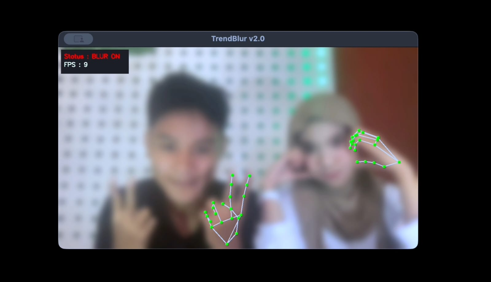

# TrendBlur

### Gesture-Controlled Camera Blur using Python & Computer Vision

TrendBlur is a real-time webcam application that uses hand gestures to control visual blur effects. By detecting hand landmarks, the application recognizes specific gestures and dynamically applies a blur effect to the camera feed.

The project combines computer vision, hand tracking, and real-time image processing to create an interactive camera experience.

---

## Documentation



---

## Features

- **Real-Time Hand Tracking** — Detects and tracks hand landmarks using MediaPipe.
- **Gesture Recognition** — Recognizes specific hand gestures, including the Peace Sign (✌️).
- **Dynamic Blur Effect** — Applies a Gaussian blur effect based on gesture detection.
- **Live Webcam Processing** — Processes camera frames in real time using OpenCV.
- **FPS Monitoring** — Displays frame-rate information during execution.
- **Interactive Controls** — Control the application through gestures and keyboard input.

## Tech Stack

| Technology | Purpose |
|---|---|
| Python 3.11 | Main programming language |
| OpenCV | Webcam access and image processing |
| MediaPipe | Hand landmark detection |
| NumPy | Numerical and image-processing operations |

## How It Works

1. TrendBlur captures live video from the webcam.
2. The video frame is processed using MediaPipe Hand Landmarker.
3. Hand landmarks are detected and analyzed.
4. The application identifies the Peace Sign gesture.
5. When the gesture is recognized, a blur effect is applied to the camera feed.
6. The visual output updates continuously in real time.

## Gesture Controls

| Gesture / Input | Action |
|---|---|
| ✌️ Peace Sign | Activate camera blur |
| Hand detected | Track hand landmarks |
| `Q` | Quit the application |

## Installation

### 1. Clone the repository

```bash
git clone https://github.com/YOUR_USERNAME/TrendBlur.git
cd TrendBlur
```

### 2. Create a virtual environment

```bash
python3.11 -m venv .venven
```

### 3. Activate the virtual environment

**macOS / Linux:**

```bash
source .venven/bin/activate
```

### 4. Install dependencies

```bash
pip install -r requirements.txt
```

### 5. Download the hand tracking model

Download the MediaPipe Hand Landmarker model:

[Download hand_landmarker.task](https://storage.googleapis.com/mediapipe-models/hand_landmarker/hand_landmarker/float16/1/hand_landmarker.task)

Place the model file in the project root directory:

```text
TrendBlur/
├── gesture_blur_cam.py
└── hand_landmarker.task
```

### 6. Run the application

```bash
python gesture_blur_cam.py
```

## Project Structure

```text
TrendBlur/
├── gesture_blur_cam.py
├── hand_landmarker.task
├── requirements.txt
├── README.md
├── .gitignore
└── doc/
    └── img1/
        └── screenshot.png
```

## Requirements

- Python 3.11
- Webcam
- macOS, Windows, or Linux
- MediaPipe-compatible environment

## Future Development

- Additional gesture-based controls
- Adjustable blur intensity
- More interactive visual effects
- Improved hand-tracking performance
- Custom gesture configuration
- User interface enhancements

---

Developed as an experimental computer vision project exploring real-time hand gesture interaction and webcam-based visual effects.

**TrendBlur — Turn gestures into visual effects.**
